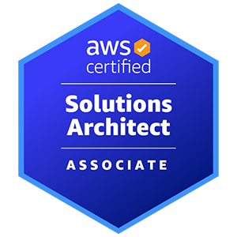

# 👋 I'm a backend developer.

I'm a developer passionate about programming and technology. I'm a lifelong learner and an inquisitive programmer!

## 🌟 **Highlighted Projects**

- [Rails Fundamental](https://github.com/danhbuidcn/rails_fundamental)  
📖 *A detailed summary of key concepts and best practices in Ruby on Rails.*

- [Go Backend Architecture](https://github.com/danhbuidcn/go_backend_api)  
📖 *A concise guide covering essential concepts and best practices for Go programming.*

- [Simple Bank Backend Service](https://github.com/danhbuidcn/simple_bank)   
📖 *This project is a step-by-step guide to designing, developing, and deploying a backend web service from scratch using Golang.*

- [Web Fundamentals](https://github.com/danhbuidcn/web_fundamental)  
📖 *A complete guide to web development, covering backend, frontend, database, CI/CD, and more.*

- [DevOps](https://github.com/danhbuidcn/devops)  
⚙️ *A comprehensive summary of basic DevOps knowledge and practices.*

## 📝 Blog

- [Viblo](https://viblo.asia/u/BuiVanThuong).

## ✨ You can follow me on

- Email: [danhbuidcn@gmail.com](mailto:danhbuidcn@gmail.com)
- LinkedIn: [LinkedIn Profile](https://www.linkedin.com/in/th%C6%B0%E1%BB%A3ng-b%C3%B9i-bb98a31b6/)
- FaceBook: [FaceBook Profile](https://www.facebook.com/danhbuidcn/)

## 🎓 Certifications

## 🛠️ Skills and Technologies

## 🙏 Thank you

Thank you for visiting my GitHub page. Please leave a star if you find my projects useful!

---
**© 2023 danhdcn.**

<!--
**danhbuidcn/danhbuidcn** is a ✨ _special_ ✨ repository because its `README.md` (this file) appears on your GitHub profile.

Here are some ideas to get you started:

- 🔭 I’m currently working on ...
- 🌱 I’m currently learning ...
- 👯 I’m looking to collaborate on ...
- 🤔 I’m looking for help with ...
- 💬 Ask me about ...
- 📫 How to reach me: ...
- 😄 Pronouns: ...
- ⚡ Fun fact: ...
-->
